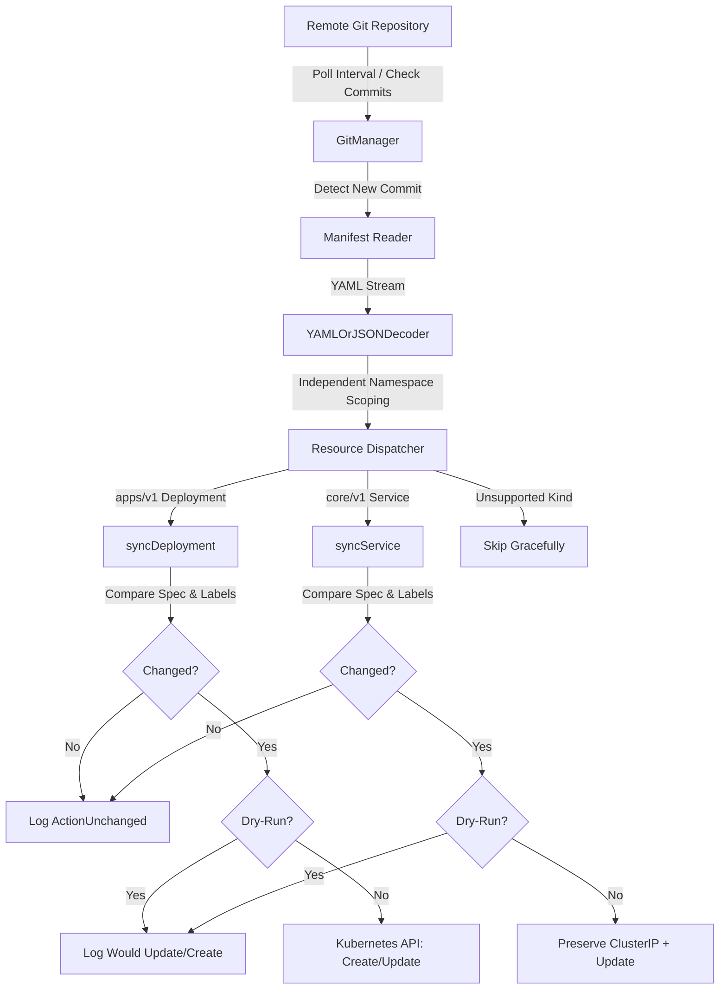

# Akit-Ops Lite

[](https://opensource.org/licenses/MIT)
[](https://go.dev/)

**Akit-Ops Lite** is a lightweight, reliable Git-to-Kubernetes synchronization engine written in Go. It continuously synchronizes desired state defined in a Git repository with the actual state in a target Kubernetes cluster, adhering to GitOps principles.


## Architecture & Workflow



---

## Architecture & Engineering Highlights

| Capability | Approach & Implementation |
| :--- | :--- |
| **Error Handling** | Idiomatic Go error wrapping (`%w`), context cancellation propagation, graceful recovery |
| **CLI & Flags** | Comprehensive CLI flags (`--repo-url`, `--interval`, `--once`, `--dry-run`) with environment variable fallbacks |
| **Validation Safety** | Strict configuration validation: rejects empty URLs, zero/negative intervals, empty namespaces |
| **Dry-Run Mode** | `--dry-run` simulates reconciliation passes without performing cluster mutations |
| **Single Run Mode** | `--once` executes a single sync pass and exits cleanly (suited for CI/CD pipelines) |
| **YAML Decoding** | Streaming decoder (`yaml.NewYAMLOrJSONDecoder`) supporting multi-document YAML manifests |
| **Namespace Isolation** | Independent document evaluation: manifests omitting namespace fall back safely to default without cross-document leakage |
| **Semantic Diffing** | Compares specs and metadata to avoid unnecessary API updates when desired state is unchanged |
| **Immutable Fields** | Preserves cluster-managed immutable fields (`ClusterIP`, `ClusterIPs`, `ResourceVersion`) during Service updates |
| **RBAC Security** | Least-privilege namespace-scoped `Role` restricted to Deployments & Services |
| **Automated Testing** | Comprehensive table-driven unit tests using `k8s.io/client-go/fake` (>60% test coverage) |
| **Lifecycle Management** | Graceful shutdown handling `SIGINT`/`SIGTERM` via `signal.NotifyContext` |

---

## Configuration & CLI Options

Configuration can be supplied via command-line flags or environment variables. **Command-line flags take precedence over environment variables.**

| Flag | Environment Variable | Default | Description |
| :--- | :--- | :--- | :--- |
| `--repo-url` | `REPO_URL` | *Required* | Git repository URL (`https://`, `git@`, or local path) |
| `--interval` | `REPO_PULL_INTERVAL` | `30s` | Polling interval (e.g., `15s`, `1m`, or seconds integer `30`) |
| `--repo-path` | `REPO_PATH` | `./deployrepo` | Local filesystem path to clone the repository |
| `--manifest` | `MANIFEST_FILE` | `manifest.yaml` | Relative path to manifest file inside repository |
| `--namespace` | `K8S_NAMESPACE` | `default` | Fallback namespace for manifests omitting `metadata.namespace` |
| `--kubeconfig` | `KUBECONFIG` | `~/.kube/config`| Path to kubeconfig (used when running out-of-cluster) |
| `--once` | `SYNC_ONCE` | `false` | Perform a single synchronization and exit |
| `--dry-run` | `DRY_RUN` | `false` | Simulate operations without modifying Kubernetes resources |

---

## Installation & Local Setup

### Prerequisites
- **Go**: 1.21 or higher
- **Kubernetes cluster**: [Minikube](https://minikube.sigs.k8s.io/), [Kind](https://kind.sigs.k8s.io/), [k3s](https://k3s.io/), or any target cluster
- **kubectl**: Configured with cluster context

### 1. Build the Binary
```bash
# Clone the repository
git clone <repository-url>
cd akit-ops

# Verify dependencies and compile
go build -o akit-ops-lite .
```

### 2. Run in Dry-Run Mode (Safe Simulation)
Simulate reconciliation against your cluster without writing any changes:
```bash
./akit-ops-lite \
  --repo-url https://github.com/your-username/k8s-manifests.git \
  --interval 15s \
  --dry-run
```

### 3. Run a Single Synchronization (CI/CD Pipeline)
Execute once and exit immediately:
```bash
./akit-ops-lite \
  --repo-url https://github.com/your-username/k8s-manifests.git \
  --once
```

### 4. Continuous Synchronization Daemon
```bash
./akit-ops-lite \
  --repo-url https://github.com/your-username/k8s-manifests.git \
  --interval 30s \
  --namespace default
```

---

## Running in Kubernetes (In-Cluster)

Akit-Ops Lite automatically detects when it is running inside a cluster via `KUBERNETES_SERVICE_HOST` and switches to the in-cluster service account configuration.

### 1. Build & Push Docker Image
```bash
docker build -t your-registry/akit-ops-lite:v1 .
docker push your-registry/akit-ops-lite:v1
```

### 2. Deploy with Least-Privilege RBAC
The provided `sa-role-rb-akit-ops.yaml` creates:
- A dedicated `ServiceAccount` (`akit-ops-sa`)
- A namespace-scoped `Role` (`akit-ops-role`) with access strictly limited to `deployments` and `services` in the target namespace
- A `RoleBinding` attaching the Role to the ServiceAccount
- A `Deployment` running as a non-root user (`UID 10001`) with CPU/memory resource limits

```bash
kubectl apply -f sa-role-rb-akit-ops.yaml
```

Check status and logs:
```bash
kubectl get pods -l app=akit-ops-lite
kubectl logs -f -l app=akit-ops-lite
```

---

## Sample Manifest (`sample-manifest.yaml`)

Akit-Ops Lite reconciles multi-document YAML manifests containing Deployments and Services:

```yaml
---
apiVersion: apps/v1
kind: Deployment
metadata:
  name: demo-webapp
  namespace: default
spec:
  replicas: 2
  selector:
    matchLabels:
      app: demo-webapp
  template:
    metadata:
      labels:
        app: demo-webapp
    spec:
      containers:
        - name: web
          image: nginx:1.25-alpine
          ports:
            - containerPort: 80
---
apiVersion: v1
kind: Service
metadata:
  name: demo-webapp-svc
  namespace: default
spec:
  type: ClusterIP
  selector:
    app: demo-webapp
  ports:
    - name: http
      port: 80
      targetPort: 80
```

---

## Automated Testing & Verification

Akit-Ops Lite includes comprehensive, table-driven unit tests that run completely offline without requiring a live cluster:

```bash
# Run all unit tests with verbose output
go test -v ./...

# Run static analysis
go vet ./...

# Check test coverage
go test -cover ./...
```

### What the Tests Verify:
1. **`TestParseConfigFlags` / `TestParseConfigEnvVars`**: Validates CLI parsing, environment variable fallbacks, duration strings, and flag precedence.
2. **`TestConfigValidation`**: Rejects missing URLs, invalid URL schemes, zero intervals in loop mode, empty manifest filenames, and empty namespaces.
3. **`TestDecodeAndSyncManifests_NamespaceIsolation`**: Proves that a manifest document with `namespace: custom-space` does not leak into subsequent documents that omit the namespace.
4. **`TestSyncDeployment_Lifecycle`**: Tests creation, change detection (skipping unchanged specs), and updates using a fake Kubernetes client.
5. **`TestSyncService_PreservesClusterIP`**: Validates that updating a Service retains immutable cluster-allocated `ClusterIP` and `ClusterIPs`.
6. **`TestDryRunMode_NeverMutatesCluster`**: Asserts that running in dry-run mode executes zero mutating API actions (`create`, `update`, `patch`, `delete`) on the client.
7. **`TestDecodeAndSyncManifests_UnsupportedAndInvalid`**: Confirms that unsupported resources (e.g., `ConfigMap`) are skipped gracefully, and malformed YAML produces a structured error without panicking.
8. **`TestGitManager_CloneAndPull`**: Tests cloning, HEAD hash tracking, and change detection using isolated local Git repositories.

---

## Security Considerations

- **Principle of Least Privilege**: Akit-Ops Lite uses a namespace-scoped `Role` rather than a `ClusterRole`. It cannot modify cluster-wide resources (nodes, namespaces) or access secrets.
- **Non-Destructive Operations**: Akit-Ops Lite **never deletes** existing resources automatically, avoiding accidental data loss.
- **Non-Root Container**: The Docker image executes as unprivileged user `10001` with `runAsNonRoot: true` and all Linux capabilities dropped.
- **Dry-Run Validation**: Before applying any changes, operators can run with `--dry-run` to preview exact synchronization actions.

---

## License
 
- Licensed under the [MIT License](LICENSE).
- References & Documentation:
  - [Kubernetes API Structure and Terminology](https://iximiuz.com/en/posts/kubernetes-api-structure-and-terminology/) by Ivan Velichko
  - [Client-go Examples](https://github.com/kubernetes/client-go/tree/master/examples)
